# salas-post1-u9 — Entrada y Salida avanzados: puertos, polling e interrupciones

**Autor:** César Hernán Salas Peñaranda  
**Curso:** Arquitectura de Computadores — Unidad 9, post-contenido (laboratorio en dos partes)  
**Repositorio único:** `salas-post1-u9`

Este repositorio reúne las dos partes del laboratorio de entrada y salida avanzados con NASM sobre DOSBox. La Parte 1 trabaja el acceso directo a puertos con `IN`/`OUT`, el polling y el polling combinado de dos puertos de estado. La Parte 2 trabaja una rutina de servicio de interrupción (ISR) para IRQ1, el enmascaramiento con el IMR del PIC 8259A, el encadenamiento de ISR y la medición de ticks en `0040h:006Ch`.

## Entorno de trabajo

| Componente | Detalle |
|---|---|
| Sistema anfitrión | Windows 11 Home |
| Emulador | DOSBox-X 2026.10.01 (`C:\DOSBox-X`), con DOSBox 0.74-3 como respaldo |
| Ensamblador | NASM 3.02 para DOS (`nasm.exe`), con el host DPMI `cwsdpmi.exe` |
| Control de versiones | Git; un commit por avance, con prefijo de parte |

El estudiante eligió DOSBox-X porque emula el controlador de teclado 8042 y el puerto paralelo, que son los dispositivos que la Parte 1 consulta directamente. `nasm.exe` y `cwsdpmi.exe` se copian a la raíz del proyecto para que DOSBox los vea como `C:\`, pero no se versionan por ser binarios de terceros (están en `.gitignore`).

El archivo `dosbox.conf` monta la raíz del repositorio como unidad `C:` y agrega la raíz al `PATH`, de modo que `C:\U9P1` y `C:\U9P2` existen tal como pide la guía. Se inicia con:

```powershell
C:\DOSBox-X\dosbox-x.exe -conf dosbox.conf
```

## Estructura del repositorio

```
salas-post1-u9/
├── README.md
├── dosbox.conf        # configuración de DOSBox-X (monta la raíz como C:\)
├── U9P1/              # Parte 1: *.ASM y *.COM
├── U9P2/              # Parte 2: *.ASM y *.COM
└── capturas/          # capturas de DOSBox-X, nombradas pN_cpM_descripcion.png
```

---

# Parte 1 — Acceso directo a puertos de E/S

## Configuración del entorno

El estudiante creó el directorio de trabajo dentro de DOSBox-X y verificó NASM:

```
mkdir C:\U9P1
nasm -v
```

La salida confirma `NASM version 3.02`.


## Paso 1 — Lectura del scancode por polling (`TECL.ASM`)

El controlador de teclado 8042 expone dos registros:

| Puerto | Registro | Propósito |
|---|---|---|
| `60h` | Data Port | Último scancode recibido o byte de respuesta |
| `64h` | Status Register | El bit 0 (OBF, Output Buffer Full) vale 1 cuando hay un dato listo en `60h` |

`TECL.ASM` sondea el puerto `64h` en el bucle `.poll` con `IN AL, 64h` y `TEST AL, 01h` hasta que OBF vale 1. Después lee el scancode con `IN AL, 60h`, lo guarda en `BL`, lo convierte a hexadecimal nibble por nibble y lo imprime con `INT 21h`, función `02h`.

Compilación y ejecución:

```
nasm -f bin TECL.ASM -o TECL.COM
TECL
```

Al presionar `A`, el programa imprime `1E`, que es el scancode *make* de esa tecla.

**Corrección respecto a la guía.** La primera ejecución con el código tal como aparece en la guía imprimió `9E` en lugar de `1E`: con las interrupciones habilitadas, el handler de la BIOS (IRQ1) leyó el puerto `60h` antes que el bucle de polling y al programa solo le llegó el código de soltar la tecla (*break* = *make* + `80h`). El estudiante agregó `CLI` antes del bucle y `STI` después de leer el dato, de modo que la BIOS no atienda IRQ1 mientras el programa sondea el puerto. Con ese cambio la salida es `1E`.

**Checkpoint 1.** `TECL.COM` compila sin errores y muestra el scancode de la tecla presionada.


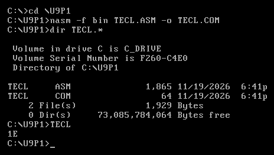

## Paso 3 — Polling con timeout (`POLL_T.ASM`)

El bucle de `TECL.ASM` puede bloquear el programa para siempre si el dispositivo nunca responde. `POLL_T.ASM` carga `CX` con `MAX_RETRY` y usa `LOOP .poll`, que decrementa `CX` y repite mientras no sea cero. Si OBF se activa, salta a `.dato_listo` y imprime el byte leído; si `CX` llega a 0, imprime el mensaje de timeout y termina.

`MAX_RETRY` vale `0005h` por defecto en el archivo, que es el valor pequeño que pide el checkpoint, y puede cambiarse al ensamblar sin editar el código:

```
nasm -f bin POLL_T.ASM -o POLL_T.COM
nasm -f bin -dMAX_RETRY=0FFFFh POLL_T.ASM -o POLL_T.COM
```

Se hicieron dos pruebas sin presionar ninguna tecla. Con `MAX_RETRY=5` aparece el mensaje de timeout, como pide el checkpoint. Con `MAX_RETRY=0FFFFh` (el valor de la guía) el timeout también aparece: 65 535 iteraciones duran apenas unos milisegundos en el emulador, un lapso demasiado corto para que una persona presione una tecla. Esta observación respalda la decisión técnica del Paso 6: el contador mide iteraciones, no tiempo.

**Checkpoint 2.** `POLL_T.COM` muestra el mensaje de timeout cuando `MAX_RETRY` es pequeño y no se presiona ninguna tecla.


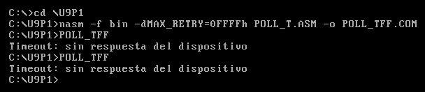

## Paso 4 — Escritura al puerto paralelo LPT1 (`LPT_1.ASM`)

El puerto paralelo centronics expone tres registros en `0378h`–`037Ah`:

| Puerto | Registro | Bits relevantes |
|---|---|---|
| `0378h` | Datos | D0–D7: el byte que se envía al conector |
| `0379h` | Estado | bit 7 BUSY# (1 = lista), bit 6 ACK# (0 = petición reconocida), bit 5 PE, bit 4 SELECT, bit 3 ERROR# |
| `037Ah` | Control | bit 0 STROBE, bit 1 AUTOFEED, bit 2 INIT, bit 3 SELECT_IN |

Protocolo implementado, con una etiqueta o bloque por cada fase:

1. `.wait_ready`: sondear `0379h` hasta que el bit 7 (BUSY#) valga 1.
2. Colocar el carácter `A` (`41h`) en `0378h` con `OUT`.
3. Pulso de STROBE sobre `037Ah`: se baja el bit 0 (`AND AL, 0FEh`), se espera un retardo corto con `.delay` y se vuelve a subir (`OR AL, 01h`).
4. `.wait_ack`: esperar ACK (bit 6 en bajo), **acotado** a `ACK_RETRY` reintentos para no bloquear el programa.

Para dejar evidencia del comportamiento, el programa imprime el valor leído de `0379h` y el resultado del ACK.

**Dos correcciones respecto a la guía:**

- **Acceso a puertos mayores que `FFh`.** La guía escribe `IN AL, STATUS_PORT` y `OUT DATA_PORT, AL` con `STATUS_PORT EQU 0379h`. La forma con puerto inmediato solo admite 8 bits, de modo que NASM no marca error sino una advertencia (`unsigned byte exceeds bounds`) y **trunca el puerto a `79h` y `78h`**, que son otros dispositivos. La captura muestra esas advertencias. La versión del repositorio carga el puerto en `DX` y usa `IN AL, DX` / `OUT DX, AL`.
- **Nombre del archivo.** `LPT1` es un nombre de dispositivo reservado en DOS (y en Windows): DOS interpreta `LPT1.ASM` y `LPT1.COM` como el puerto de impresora, no como archivos (`dir LPT1.*` responde `File not found` y `nasm` no genera el `.COM`). El programa se llama por eso `LPT_1.ASM` / `LPT_1.COM`.

**Comportamiento observado en DOSBox-X.** El acceso a los puertos no produce ningún error. El registro de estado `0379h` devuelve `DFh` (`1101 1111b`): BUSY# = 1 (lista), ACK# = 1 (inactivo), PE = 0, SELECT = 1 y ERROR# = 1. Como BUSY# ya está en 1, el bucle `.wait_ready` termina en la primera iteración. Al no haber impresora, el ACK nunca baja y el programa informa `Sin ACK` tras agotar los reintentos, sin bloquearse.

**Checkpoint 3.** `LPT_1.COM` compila y se ejecuta sin errores de acceso a puerto ni bloqueo.


## Paso 5 — Polling combinado de dos puertos de estado (`MULTI_ST.ASM`)

`TECL.ASM` y `POLL_T.ASM` sondean un único puerto. `MULTI_ST.ASM` espera el primero de dos eventos distintos: OBF del 8042 (bit 0 de `64h`) o el bit de listo de LPT1 (bit 7 de `0379h`). La combinación funciona así:

1. De cada registro se aísla el bit relevante con `AND` y se normaliza a 0 o 1 (para LPT1, con `SHR AL, 7`).
2. Las banderas quedan separadas: `BL` = teclado y `BH` = LPT1.
3. Se combinan con `MOV AL, BL` y `OR AL, BH`. El resultado solo vale cero cuando ningún dispositivo está listo, y entonces `JZ .poll` repite el bucle.
4. Al salir, el OR ya no dice quién disparó la condición; por eso el programa examina `BL` y `BH` por separado con `TEST` e imprime el mensaje de cada dispositivo que estaba listo (uno, otro o ambos).

Las constantes `KBD_STATUS_PORT`, `KBD_OBF_MASK`, `LPT_STATUS_PORT` y `LPT_READY_MASK` dan nombre a los puertos y a las máscaras.

**Correcciones respecto a la guía:** el puerto `0379h` se lee con `IN AL, DX` (misma razón que en el Paso 4) y se agregó `CLI`/`STI` alrededor del bucle (misma razón que en el Paso 1).

**Cómo se obtuvieron los tres casos.** En DOSBox-X el LPT1 reporta siempre BUSY# = 1, de modo que la primera iteración ya termina el bucle:

- **Solo LPT1:** `MULTI_ST` sin tocar el teclado imprime únicamente `LPT1 listo (BUSY#=1).`
- **Ambos:** para que OBF ya valga 1 cuando empieza el bucle, el auxiliar `RETENER.COM` (no es parte de la guía) enmascara IRQ1 durante unos 8 segundos y la tecla `a` queda retenida en el buffer del 8042. Al ejecutar después `MULTI_ST`, las dos banderas valen 1 y se imprimen los dos mensajes.
- **Solo teclado:** como LPT1 siempre está listo, la rama solo-teclado no es alcanzable en DOSBox-X. Para comprobarla se ensambló una variante con `-dIGNORAR_LPT`, que fuerza `BH = 0`; el programa espera la tecla y solo imprime `Teclado listo (OBF=1).`

```
nasm -f bin MULTI_ST.ASM -o MULTI_ST.COM
nasm -f bin RETENER.ASM -o RETENER.COM
nasm -f bin -dIGNORAR_LPT MULTI_ST.ASM -o MULTI_K.COM
```

**Checkpoint 4.** `MULTI_ST.COM` compila sin errores y en cada ejecución identifica cuál de los puertos disparó la salida del bucle.

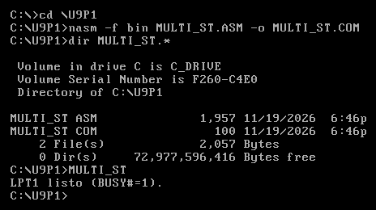
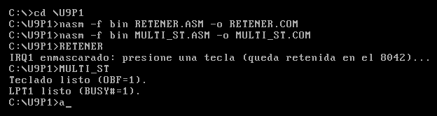
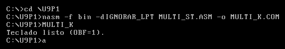

## Paso 6 — Decisión técnica: ¿polling sin límite o polling con timeout configurable?

<!-- decision-1:inicio -->
El estudiante considera que el bucle sin límite de `TECL.ASM` es aceptable únicamente cuando el dispositivo está garantizado a responder, como en un programa de demostración donde el propio estudiante presiona la tecla: si la tecla nunca llega, basta con que la persona actúe. En cualquier programa que no pueda asumir que el dispositivo responderá, el timeout configurable de `POLL_T.ASM` es indispensable, porque convierte una espera indefinida en una espera acotada que permite informar el fallo y terminar con limpieza. El costo es que `MAX_RETRY` puede dar falsos timeouts: si se reduce demasiado, por ejemplo a `5h` en lugar de `0FFFFh`, el programa se rinde antes de que un dispositivo lento pero funcional alcance a responder, y reporta un fallo que no existe. La Parte 1 lo mostró de forma directa: con `MAX_RETRY=5` el timeout es inmediato, y con `0FFFFh` también expiró antes de que una persona pudiera presionar una tecla. La razón de fondo es que el contador mide iteraciones del bucle y no tiempo real. Cuántas iteraciones equivalen a un segundo depende de la velocidad de la CPU o del emulador (por ejemplo, del valor de `cycles`), de modo que es una medida de tiempo indirecta y poco confiable. El contador de ticks de `0040h:006Ch`, impulsado por IRQ0 a unos 18.2 ticks por segundo, mide tiempo real sin importar qué tan rápido se ejecute el bucle que lo consulta, y por eso es la forma correcta de acotar una espera en segundos.
<!-- decision-1:fin -->

## Paso 7 — Decisión técnica: ¿combinar las banderas con OR o verificarlas por separado?

<!-- decision-2:inicio -->
Si LPT1 reporta su bit de listo en 1 de forma permanente, el bucle `.poll` de `MULTI_ST.ASM` se detiene en la primera iteración sin importar el estado del teclado. Eso fue exactamente lo observado en DOSBox-X, donde `0379h` devuelve `DFh`: el programa termina de inmediato y la espera combinada pierde su propósito, porque nunca espera realmente al segundo dispositivo; para ver el caso de ambos dispositivos hubo que retener antes una tecla con un auxiliar. Después de salir del bucle es necesario examinar `BL` y `BH` por separado, porque el OR descarta la información de cuál bandera individual causó la salida: solo informa que al menos una vale 1, y el programa necesita saber cuál para atender al dispositivo correcto, o a ambos si coincidieron. Si en lugar de OR se combinaran las banderas con AND, el programa esperaría que ambas condiciones se cumplan simultáneamente. Eso tiene sentido en una sincronización tipo rendezvous: por ejemplo, no enviar un dato a la impresora hasta que el usuario haya presionado una tecla y la impresora esté lista. El OR, en cambio, solo necesita que ocurra el primero de los dos eventos, y es la herramienta adecuada cuando cualquiera de ellos basta para continuar.
<!-- decision-2:fin -->

**Checkpoint 5.** Las dos decisiones técnicas de la Parte 1 (Pasos 6 y 7) están incluidas arriba. Las capturas muestran cada texto tal como está en este README.

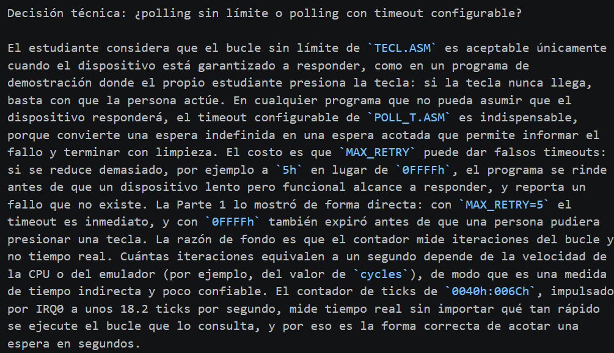
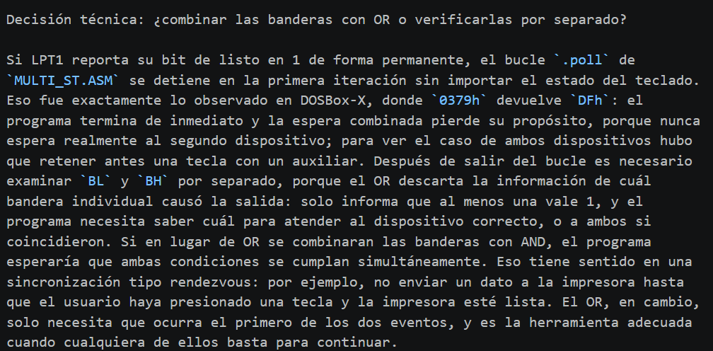

---

# Parte 2 — ISR personalizado y programación del PIC 8259A

## Configuración del entorno

El directorio de trabajo de esta parte, `C:\U9P2`, se creó también desde DOSBox-X con `mkdir C:\U9P2`.

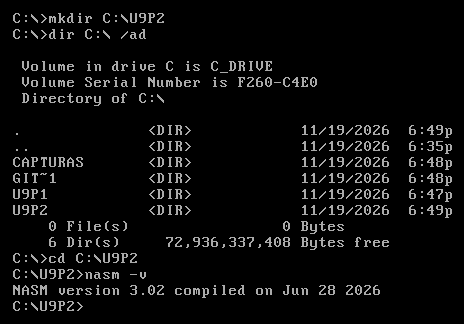

## Conceptos: PIC 8259A, vector de IRQ1, IMR y EOI

El PIC 8259A maestro traduce las líneas IRQ0–IRQ7 a vectores de interrupción a partir de la base `08h`: IRQ0 (timer) es `INT 08h`, **IRQ1 (teclado) es `INT 09h`** e IRQ7 (LPT1) es `INT 0Fh`. El CPU atiende una interrupción solo si el flag `IF` está en 1 y si la IRQ no está enmascarada.

| Elemento | Puerto | Función |
|---|---|---|
| IMR (Interrupt Mask Register) | `21h` | Un bit en 1 enmascara (deshabilita) la IRQ correspondiente; en 0 la habilita. IRQ1 es el bit 1 (`02h`) |
| Comando / EOI | `20h` | Al escribir `20h` (End Of Interrupt) el ISR avisa al PIC que terminó, y el PIC puede despachar otras IRQ pendientes |

Los vectores se leen y fijan con `INT 21h`: `AH=35h` devuelve el handler actual en `ES:BX`, y `AH=25h` instala uno nuevo desde `DS:DX`.

## Paso 1 — Instalación del ISR propio (`ISR_KB.ASM`)

El programa (1) guarda el vector original de `INT 09h`, (2) instala `mi_isr`, (3) espera cinco pulsaciones en un bucle activo sobre `contador` y (4) restaura el vector original. Las secciones `.data` (constantes, variables y mensajes) y `.text` están delimitadas. Para dejar evidencia de cómo se instala y restaura el vector, el programa imprime `SEG:OFF` del vector tres veces: antes de instalar, después de instalar (releído con `AH=35h`) y después de restaurar.

El ISR hace lo siguiente, en este orden: guarda `AX`, `DX` y `DS`; apunta `DS` a su segmento; lee y descarta el scancode con `IN AL, 60h`; imprime el mensaje; incrementa `contador`; envía el EOI (`OUT 20h, AL`) y restaura los registros antes del `IRET`.

```
nasm -f bin ISR_KB.ASM -o ISR_KB.COM
ISR_KB
```

**Correcciones respecto a la guía:**

- **`DS` tras `LDS`.** En la restauración, `LDS DX, [old_isr]` carga `DS` con el segmento del handler original (la BIOS), y el código de la guía imprime después `msg_fin` con ese `DS`, de modo que `DX` ya no apuntaría al texto del programa. Aquí `DS` se guarda con `PUSH DS` antes del `LDS` y se repone con `POP DS`.
- **Make y break.** Cada pulsación completa genera dos interrupciones de IRQ1: el scancode *make* al presionar y el *break* (con el bit 7 en 1) al soltar. Para que el contador cuente pulsaciones y no interrupciones, el ISR descarta los códigos con el bit 7 en 1 (`TEST AL, 80h`), pero sigue enviando el EOI en ese caso.

**Resultado.** El vector original es `F000:E987` (la BIOS), el instalado es `12E6:016C` (dentro del programa) y tras la restauración vuelve a `F000:E987`. El mensaje aparece exactamente cinco veces.

**Checkpoint 1.** `ISR_KB.COM` compila sin errores, muestra `Tecla detectada por ISR propio` cinco veces y termina con el mensaje de restauración.

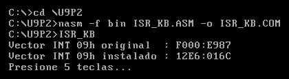
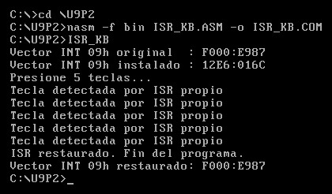

## Paso 2 — Enmascaramiento de IRQ1 con el IMR (`MASK_KB.ASM`)

El programa lee el IMR con `IN AL, 21h` y lo guarda en `imr_orig`, activa el bit 1 con `OR AL, 02h` y lo escribe con `OUT 21h, AL`. Espera unos 3 segundos con el contador de ticks de la BIOS (`INT 1Ah`, función `00h`; 55 ticks a 18.2 por segundo) y restaura el valor original. Al terminar vuelve a leer el IMR para comprobar la restauración.

**Correcciones y ampliaciones respecto a la guía:**

- **Datos después del código.** La guía coloca `msg_mask` y `msg_unmask` antes de `start`. En un `.COM` la ejecución empieza en `0100h`, de modo que el procesador ejecutaría el texto como instrucciones. Los datos se movieron al final del programa.
- **Espera segura.** La comparación se hace con la diferencia `DX - tick_inicial` y `JB`, que sigue funcionando si la palabra baja del contador da la vuelta durante la espera.
- **Evidencia del enmascaramiento.** Antes de restaurar el IMR, el programa lee el bit OBF del 8042 (`64h`) e informa si quedó un scancode retenido. Además imprime el IMR antes, durante y después.

```
nasm -f bin MASK_KB.ASM -o MASK_KB.COM
MASK_KB
```

**Resultado.** El IMR pasa de `F8h` a `FAh` (se activa el bit 1) y vuelve a `F8h`. Sin presionar teclas, el 8042 queda vacío (`OBF=0`). Al presionar teclas durante el enmascarado, el 8042 conserva el scancode (`OBF=1`) porque la BIOS no lo atiende: no se produce ningún efecto en pantalla durante esos 3 segundos. Al restaurar el IMR, IRQ1 se atiende de nuevo y las teclas pendientes llegan al sistema, por eso `asd` aparece en el prompt después del mensaje final.

**Checkpoint 2.** Durante `MASK_KB.COM` las pulsaciones no producen salida mientras IRQ1 está enmascarado, y al finalizar el programa muestra `IRQ1 restaurado` y termina correctamente.

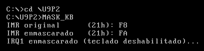
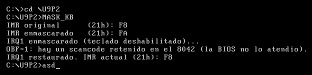
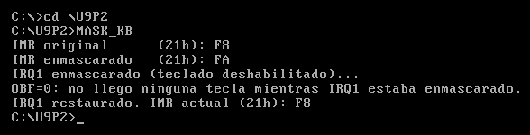
