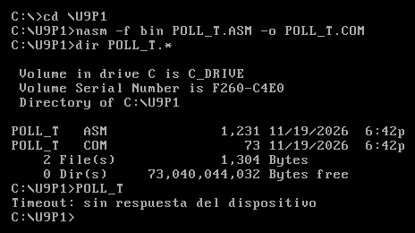
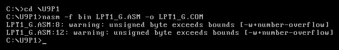
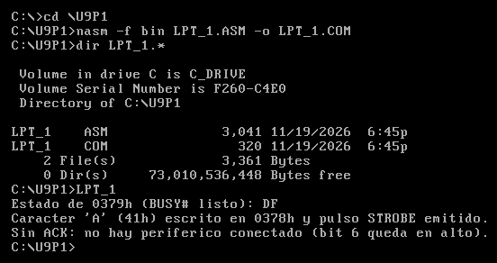

# salas-post1-u9 — Entrada y Salida avanzados: puertos, polling e interrupciones

**Autor:** César Hernán Salas Peñaranda  
**Curso:** Arquitectura de Computadores — Unidad 9, post-contenido (laboratorio en dos partes)  
**Repositorio único:** `salas-post1-u9`

Este repositorio reúne las dos partes del laboratorio de entrada y salida avanzados con NASM sobre DOSBox. La Parte 1 trabaja el acceso directo a puertos con `IN`/`OUT`, el polling y el polling combinado de dos puertos de estado. La Parte 2 trabaja una rutina de servicio de interrupción (ISR) para IRQ1, el enmascaramiento con el IMR del PIC 8259A, el encadenamiento de ISR y la medición de ticks en `0040h:006Ch`.

## Entorno de trabajo

| Componente | Detalle |
|---|---|
| Sistema anfitrión | Windows 11 Home |
| Emulador | DOSBox-X 2026.10.01 (`C:\DOSBox-X`), con DOSBox 0.74-3 como respaldo |
| Ensamblador | NASM 3.02 para DOS (`nasm.exe`), con el host DPMI `cwsdpmi.exe` |
| Control de versiones | Git; un commit por avance, con prefijo de parte |

El estudiante eligió DOSBox-X porque emula el controlador de teclado 8042 y el puerto paralelo, que son los dispositivos que la Parte 1 consulta directamente. `nasm.exe` y `cwsdpmi.exe` se copian a la raíz del proyecto para que DOSBox los vea como `C:\`, pero no se versionan por ser binarios de terceros (están en `.gitignore`).

El archivo `dosbox.conf` monta la raíz del repositorio como unidad `C:` y agrega la raíz al `PATH`, de modo que `C:\U9P1` y `C:\U9P2` existen tal como pide la guía. Se inicia con:

```powershell
C:\DOSBox-X\dosbox-x.exe -conf dosbox.conf
```

## Estructura del repositorio

```
salas-post1-u9/
├── README.md
├── dosbox.conf        # configuración de DOSBox-X (monta la raíz como C:\)
├── U9P1/              # Parte 1: *.ASM y *.COM
├── U9P2/              # Parte 2: *.ASM y *.COM
└── capturas/          # capturas de DOSBox-X, nombradas pN_cpM_descripcion.png
```

---

# Parte 1 — Acceso directo a puertos de E/S

## Configuración del entorno

El estudiante creó el directorio de trabajo dentro de DOSBox-X y verificó NASM:

```
mkdir C:\U9P1
nasm -v
```

La salida confirma `NASM version 3.02`.


## Paso 1 — Lectura del scancode por polling (`TECL.ASM`)

El controlador de teclado 8042 expone dos registros:

| Puerto | Registro | Propósito |
|---|---|---|
| `60h` | Data Port | Último scancode recibido o byte de respuesta |
| `64h` | Status Register | El bit 0 (OBF, Output Buffer Full) vale 1 cuando hay un dato listo en `60h` |

`TECL.ASM` sondea el puerto `64h` en el bucle `.poll` con `IN AL, 64h` y `TEST AL, 01h` hasta que OBF vale 1. Después lee el scancode con `IN AL, 60h`, lo guarda en `BL`, lo convierte a hexadecimal nibble por nibble y lo imprime con `INT 21h`, función `02h`.

Compilación y ejecución:

```
nasm -f bin TECL.ASM -o TECL.COM
TECL
```

Al presionar `A`, el programa imprime `1E`, que es el scancode *make* de esa tecla.

**Corrección respecto a la guía.** La primera ejecución con el código tal como aparece en la guía imprimió `9E` en lugar de `1E`: con las interrupciones habilitadas, el handler de la BIOS (IRQ1) leyó el puerto `60h` antes que el bucle de polling y al programa solo le llegó el código de soltar la tecla (*break* = *make* + `80h`). El estudiante agregó `CLI` antes del bucle y `STI` después de leer el dato, de modo que la BIOS no atienda IRQ1 mientras el programa sondea el puerto. Con ese cambio la salida es `1E`.

**Checkpoint 1.** `TECL.COM` compila sin errores y muestra el scancode de la tecla presionada.


## Paso 3 — Polling con timeout (`POLL_T.ASM`)

El bucle de `TECL.ASM` puede bloquear el programa para siempre si el dispositivo nunca responde. `POLL_T.ASM` carga `CX` con `MAX_RETRY` y usa `LOOP .poll`, que decrementa `CX` y repite mientras no sea cero. Si OBF se activa, salta a `.dato_listo` y imprime el byte leído; si `CX` llega a 0, imprime el mensaje de timeout y termina.

`MAX_RETRY` vale `0005h` por defecto en el archivo, que es el valor pequeño que pide el checkpoint, y puede cambiarse al ensamblar sin editar el código:

```
nasm -f bin POLL_T.ASM -o POLL_T.COM
nasm -f bin -dMAX_RETRY=0FFFFh POLL_T.ASM -o POLL_T.COM
```

Se hicieron dos pruebas sin presionar ninguna tecla. Con `MAX_RETRY=5` aparece el mensaje de timeout, como pide el checkpoint. Con `MAX_RETRY=0FFFFh` (el valor de la guía) el timeout también aparece: 65 535 iteraciones duran apenas unos milisegundos en el emulador, un lapso demasiado corto para que una persona presione una tecla. Esta observación respalda la decisión técnica del Paso 6: el contador mide iteraciones, no tiempo.

**Checkpoint 2.** `POLL_T.COM` muestra el mensaje de timeout cuando `MAX_RETRY` es pequeño y no se presiona ninguna tecla.




## Paso 4 — Escritura al puerto paralelo LPT1 (`LPT_1.ASM`)

El puerto paralelo centronics expone tres registros en `0378h`–`037Ah`:

| Puerto | Registro | Bits relevantes |
|---|---|---|
| `0378h` | Datos | D0–D7: el byte que se envía al conector |
| `0379h` | Estado | bit 7 BUSY# (1 = lista), bit 6 ACK# (0 = petición reconocida), bit 5 PE, bit 4 SELECT, bit 3 ERROR# |
| `037Ah` | Control | bit 0 STROBE, bit 1 AUTOFEED, bit 2 INIT, bit 3 SELECT_IN |

Protocolo implementado, con una etiqueta o bloque por cada fase:

1. `.wait_ready`: sondear `0379h` hasta que el bit 7 (BUSY#) valga 1.
2. Colocar el carácter `A` (`41h`) en `0378h` con `OUT`.
3. Pulso de STROBE sobre `037Ah`: se baja el bit 0 (`AND AL, 0FEh`), se espera un retardo corto con `.delay` y se vuelve a subir (`OR AL, 01h`).
4. `.wait_ack`: esperar ACK (bit 6 en bajo), **acotado** a `ACK_RETRY` reintentos para no bloquear el programa.

Para dejar evidencia del comportamiento, el programa imprime el valor leído de `0379h` y el resultado del ACK.

**Dos correcciones respecto a la guía:**

- **Acceso a puertos mayores que `FFh`.** La guía escribe `IN AL, STATUS_PORT` y `OUT DATA_PORT, AL` con `STATUS_PORT EQU 0379h`. La forma con puerto inmediato solo admite 8 bits, de modo que NASM no marca error sino una advertencia (`unsigned byte exceeds bounds`) y **trunca el puerto a `79h` y `78h`**, que son otros dispositivos. La captura muestra esas advertencias. La versión del repositorio carga el puerto en `DX` y usa `IN AL, DX` / `OUT DX, AL`.
- **Nombre del archivo.** `LPT1` es un nombre de dispositivo reservado en DOS (y en Windows): DOS interpreta `LPT1.ASM` y `LPT1.COM` como el puerto de impresora, no como archivos (`dir LPT1.*` responde `File not found` y `nasm` no genera el `.COM`). El programa se llama por eso `LPT_1.ASM` / `LPT_1.COM`.

**Comportamiento observado en DOSBox-X.** El acceso a los puertos no produce ningún error. El registro de estado `0379h` devuelve `DFh` (`1101 1111b`): BUSY# = 1 (lista), ACK# = 1 (inactivo), PE = 0, SELECT = 1 y ERROR# = 1. Como BUSY# ya está en 1, el bucle `.wait_ready` termina en la primera iteración. Al no haber impresora, el ACK nunca baja y el programa informa `Sin ACK` tras agotar los reintentos, sin bloquearse.

**Checkpoint 3.** `LPT_1.COM` compila y se ejecuta sin errores de acceso a puerto ni bloqueo.



