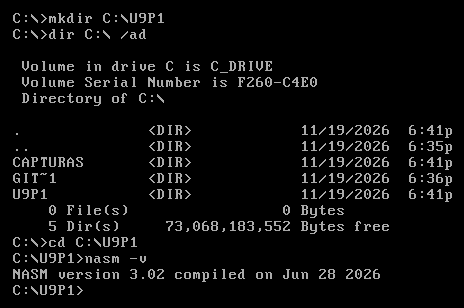

# salas-post1-u9 — Entrada y Salida avanzados: puertos, polling e interrupciones

**Autor:** César Hernán Salas Peñaranda  
**Curso:** Arquitectura de Computadores — Unidad 9, post-contenido (laboratorio en dos partes)  
**Repositorio único:** `salas-post1-u9`

Este repositorio reúne las dos partes del laboratorio de entrada y salida avanzados con NASM sobre DOSBox. La Parte 1 trabaja el acceso directo a puertos con `IN`/`OUT`, el polling y el polling combinado de dos puertos de estado. La Parte 2 trabaja una rutina de servicio de interrupción (ISR) para IRQ1, el enmascaramiento con el IMR del PIC 8259A, el encadenamiento de ISR y la medición de ticks en `0040h:006Ch`.

## Entorno de trabajo

| Componente | Detalle |
|---|---|
| Sistema anfitrión | Windows 11 Home |
| Emulador | DOSBox-X 2026.10.01 (`C:\DOSBox-X`), con DOSBox 0.74-3 como respaldo |
| Ensamblador | NASM 3.02 para DOS (`nasm.exe`), con el host DPMI `cwsdpmi.exe` |
| Control de versiones | Git; un commit por avance, con prefijo de parte |

El estudiante eligió DOSBox-X porque emula el controlador de teclado 8042 y el puerto paralelo, que son los dispositivos que la Parte 1 consulta directamente. `nasm.exe` y `cwsdpmi.exe` se copian a la raíz del proyecto para que DOSBox los vea como `C:\`, pero no se versionan por ser binarios de terceros (están en `.gitignore`).

El archivo `dosbox.conf` monta la raíz del repositorio como unidad `C:` y agrega la raíz al `PATH`, de modo que `C:\U9P1` y `C:\U9P2` existen tal como pide la guía. Se inicia con:

```powershell
C:\DOSBox-X\dosbox-x.exe -conf dosbox.conf
```

## Estructura del repositorio

```
salas-post1-u9/
├── README.md
├── dosbox.conf        # configuración de DOSBox-X (monta la raíz como C:\)
├── U9P1/              # Parte 1: *.ASM y *.COM
├── U9P2/              # Parte 2: *.ASM y *.COM
└── capturas/          # capturas de DOSBox-X, nombradas pN_cpM_descripcion.png
```

---

# Parte 1 — Acceso directo a puertos de E/S

## Configuración del entorno

El estudiante creó el directorio de trabajo dentro de DOSBox-X y verificó NASM:

```
mkdir C:\U9P1
nasm -v
```

La salida confirma `NASM version 3.02`.


